<div align="center">


# Cairn

**A fast, friendly git client for people who outgrew the basics.**

Native Rust, GPU-rendered with [GPUI](https://gpui.rs). Every risky operation is one click from undone.

[](https://github.com/JackLuciano/cairn/actions/workflows/ci.yml)
[](#license)
[](#install)
[](https://www.rust-lang.org)
[](#languages)

[Features](#features) · [Install](#install) · [Shortcuts](#keyboard-shortcuts) · [AI](#ask-ai) · [Build from source](#build-from-source) · [Code signing policy](CODE_SIGNING_POLICY.md)

<br>

<picture>
  <source media="(prefers-color-scheme: light)" srcset="docs/screenshots/light/history.png">
  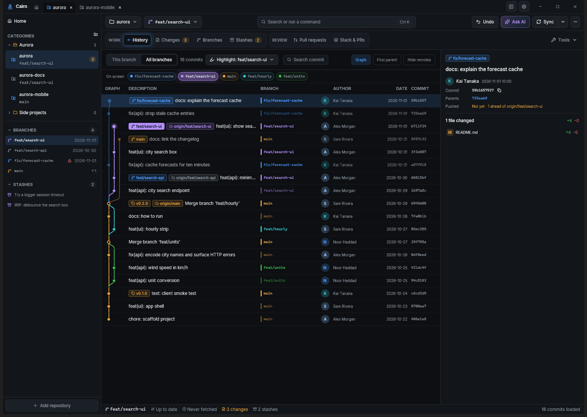
</picture>

</div>

## Why Cairn

Most git clients are either a thin layer over the basics or a wall of buttons. Cairn keeps the
everyday flow calm, and makes the powerful things safe:

- **Nothing is scary.** Cairn saves an undo point before every operation. A bad rebase, reset or
  amend is one click away from being undone.
- **The advanced stuff is built in.** Interactive rebase, absorb, split, stacked pull requests,
  a three-way conflict editor and bisect work without memorizing a single flag.
- **Many repositories, one place.** Group repositories into categories and commit, pull or push
  several of them together.
- **Fast.** A native Rust app drawn on the GPU, no Electron, no web view.

## Features

### Everyday git, done right

<table>
<tr>
<td width="50%">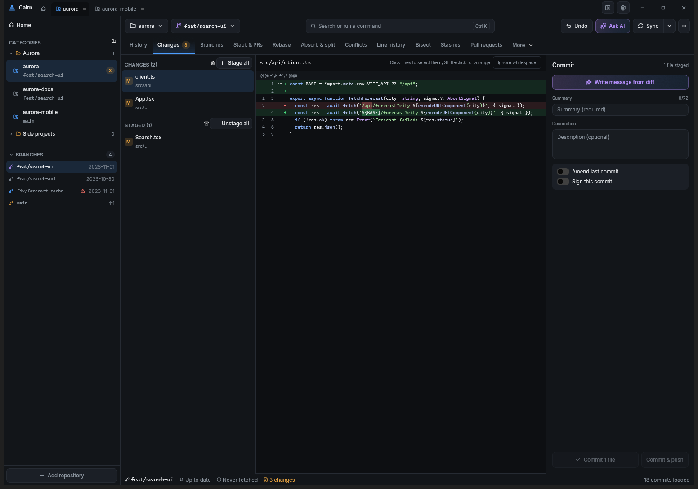</td>
<td width="50%">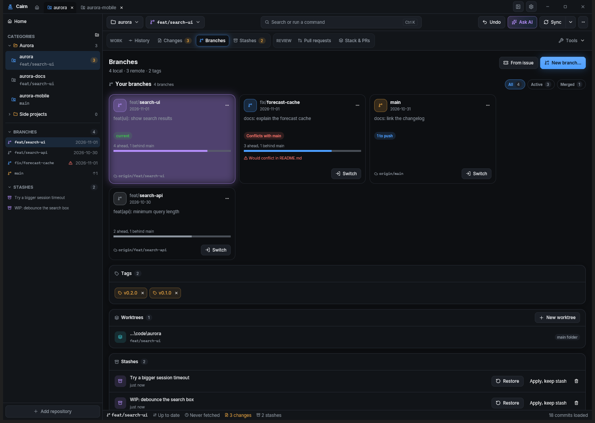</td>
</tr>
<tr>
<td><b>Line-by-line staging.</b> Click lines in a diff to stage, unstage or discard exactly what
you mean. Switch between unified and split view, jump from change to change, and see on the
change map where a file changed. Image diffs come in side-by-side, swipe and onion-skin modes.</td>
<td><b>Branches at a glance.</b> Every branch is a card with its last commit, pull request, how
far ahead or behind <code>main</code> it is and whether it would conflict. Filter to the active
ones, or to the merged ones you can clean up.</td>
</tr>
</table>

<table>
<tr>
<td width="50%">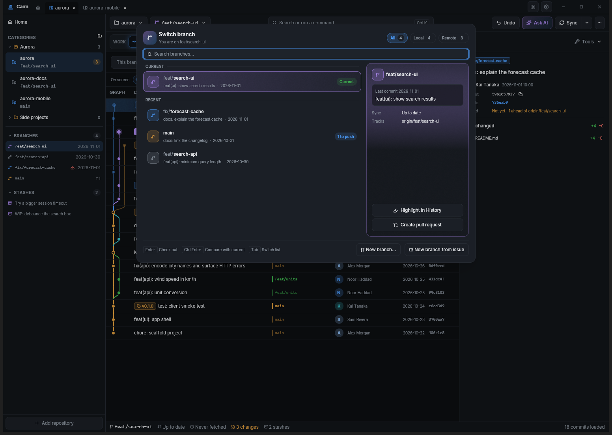</td>
<td width="50%">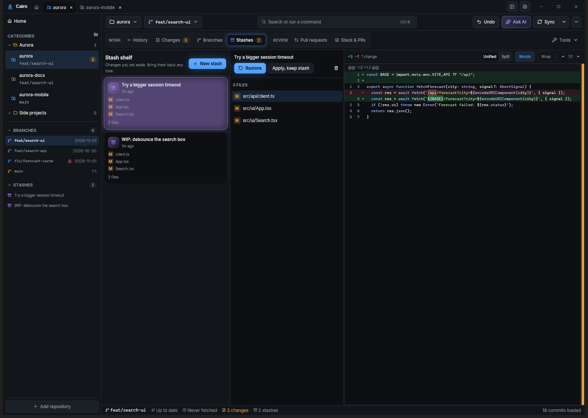</td>
</tr>
<tr>
<td><b>Find any branch in a second.</b> Type a few letters to filter hundreds of branches. Recent
ones come first, and each shows its last commit, pull request and what is waiting to pull.
Switch, compare, highlight it in History or open a pull request from the same window.</td>
<td><b>Stashes you can recognise.</b> Each stash shows the files inside, the branch it came from
and how old it is. Apply, pop or drop it from the card.</td>
</tr>
</table>

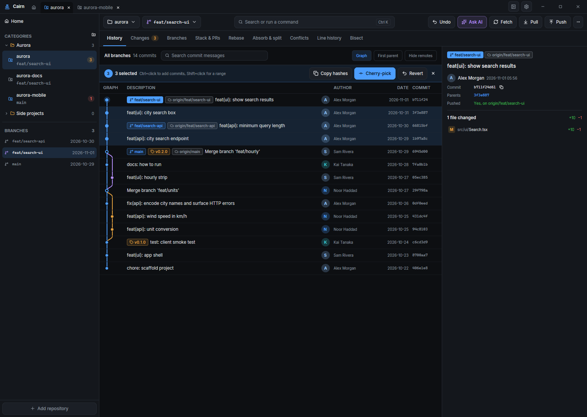

**Work on many commits at once.** Ctrl+click or Shift+click commits in History, then copy all
their hashes, cherry-pick them or revert them in one step. Cairn applies them in the order they
were made, whatever order you clicked them in.

**AI commit messages.** "Write message from diff" drafts a summary and description from your
staged changes. Tell it how you like your messages in Settings → Commits, or share rules with
your team in `.cairn/commit-message.md`.

**History that stays readable.** History opens on the branch you are on, so twenty open feature
branches don't turn the graph into a wall of lines. Switch to "All branches" when you want the
whole picture: every commit is labeled with the branch it was made on, each branch keeps one
color from its line to its label, and merged branches get their name back from the merge
message. Commits that are not on your branch fade out; click any branch in the legend to
highlight it instead. Hover a commit for a quick card, and older commits load as you scroll.

**Drag and drop.** Drag a branch label onto another branch to merge or rebase it, or drag commits
onto a branch to cherry-pick them. Cairn always asks first and tells you if it needs to switch
branches.

### Find anything, undo anything

- **File history.** Every commit that changed a file, followed through renames, with the change
  each one made.
- **Compare.** Pick any two branches, tags or commits and see what is only on each side and how
  the files differ.
- **Lost & found.** Deleted a branch, reset too far or dropped a stash? Cairn lists the commits
  nothing points at any more and brings them back as a branch in one click.
- **Stashes, properly.** Stash only some files, or only the blocks and lines you staged. Look
  inside a stash before applying it and restore single files from it.
- **Go to file (Ctrl+P).** Type part of any file name to open its history, its line history or
  the file itself.
- **Conflicts before they happen.** Cairn checks quietly in the background whether your branches
  and open pull requests would conflict with `main`, and names the files.

<table>
<tr>
<td width="50%">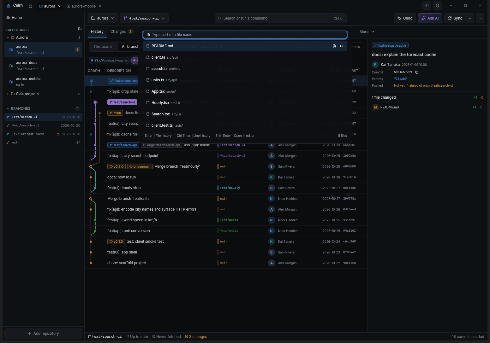</td>
<td width="50%">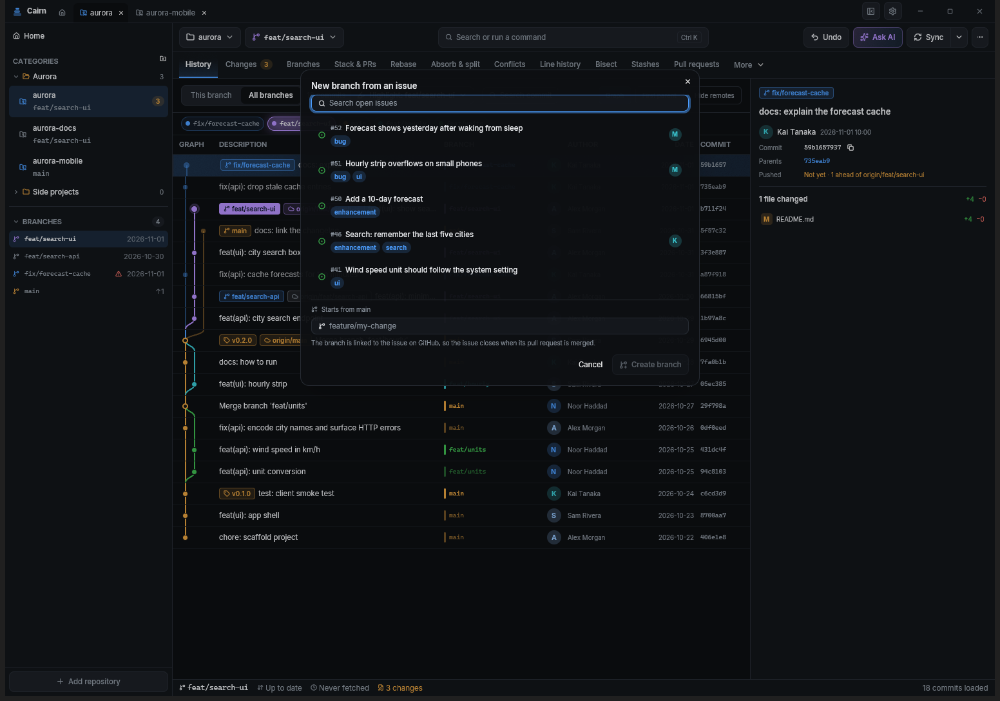</td>
</tr>
</table>

### Pull requests, submodules and large files

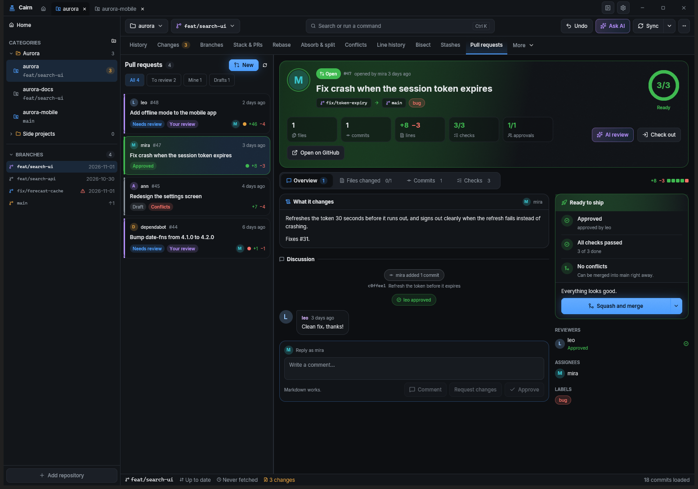

- **Review pull requests in Cairn.** A ring shows what each pull request still needs (reviews,
  checks, conflicts) and what to do next. Read the conversation, commits and checks, tick off
  files as you review them (Cairn remembers, and unticks a file when it changes again), comment
  on a line, approve or request changes, check it out locally and merge it. Uses the GitHub CLI.
- **Open pull requests from Cairn.** Pick the base branch, reviewers and labels, and let AI write
  the title and description from your commits. Branches that were never pushed are published
  for you.
- **AI review.** One click and Claude reads the whole pull request and drafts review comments on
  the exact lines. Untick what you don't want to say and post the rest as one review.
- **Branches from issues.** Pick an open issue and get a branch named after it, linked to the
  issue on GitHub.

- **One commit at a time.** Click any commit of a pull request to see only what it changed, and
  step through them in order.

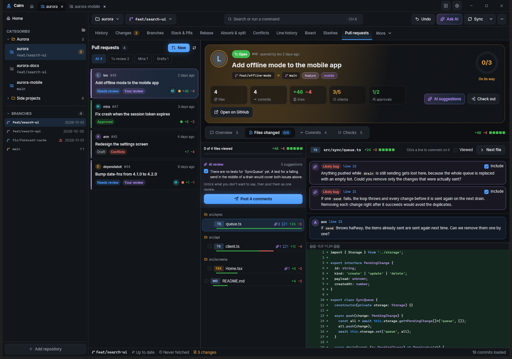

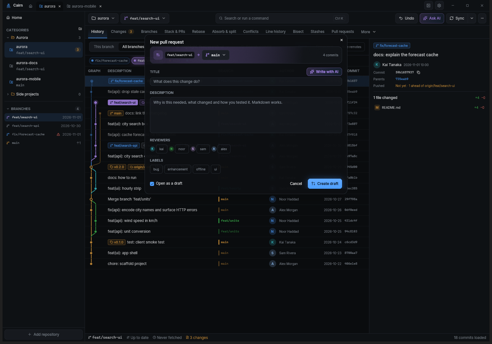

- **Submodules.** See which are missing or on a different commit, download and update them, add
  new ones and open them as their own tab.
- **Git LFS.** Track file types, download LFS files, and lock and unlock files your team edits.

### Your tools

Open files and repositories in your editor, send a diff to your external diff tool or a conflict
to your merge tool, ignore a file or a whole file type from the Changes list, and save commits as
a patch or apply someone else's. Set your programs in Settings → Tools.

### Rewrite history without fear

<table>
<tr>
<td width="50%">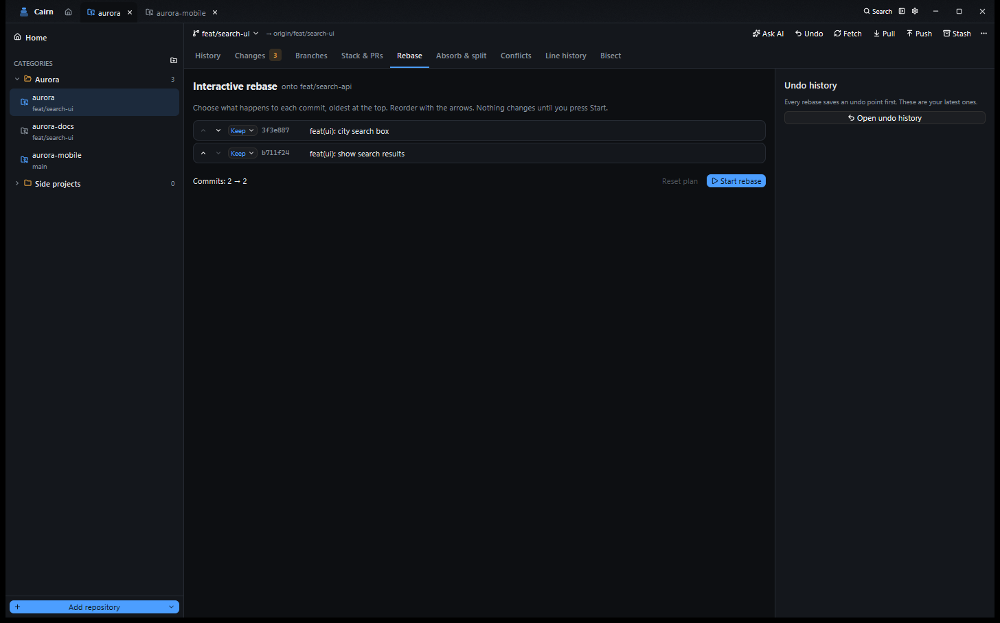</td>
<td width="50%">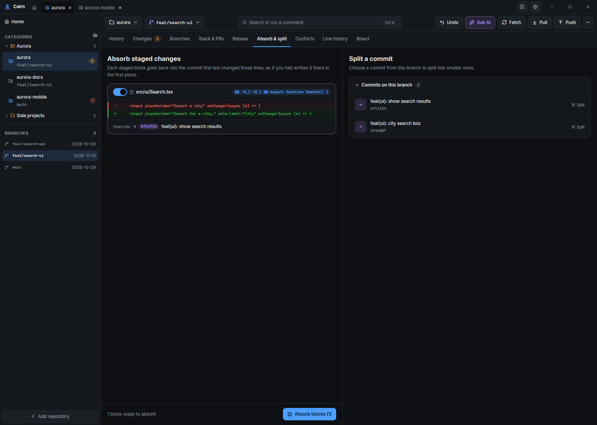</td>
</tr>
<tr>
<td><b>Interactive rebase.</b> Reorder, reword, squash, fix up or drop commits. <code>fixup!</code>
commits land in the right place automatically, and stacked branches move along.</td>
<td><b>Absorb and split.</b> Staged fixes jump into the commit that last touched those lines.
Split a commit that grew too big into several clean ones.</td>
</tr>
</table>

### Conflicts and stacks

<table>
<tr>
<td width="50%">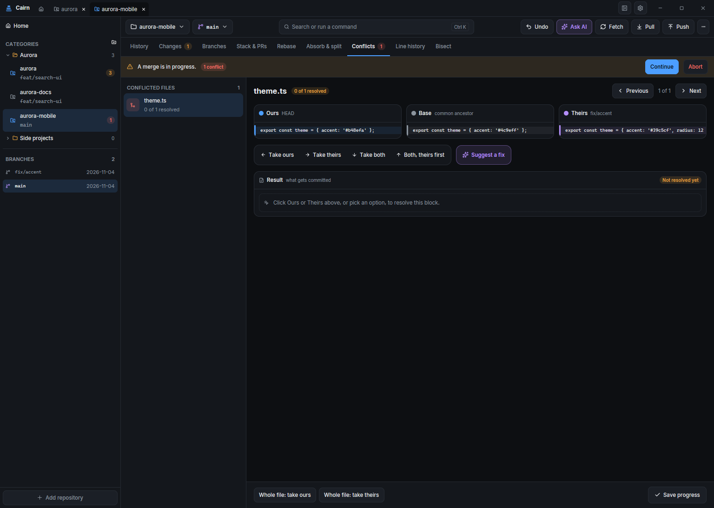</td>
<td width="50%">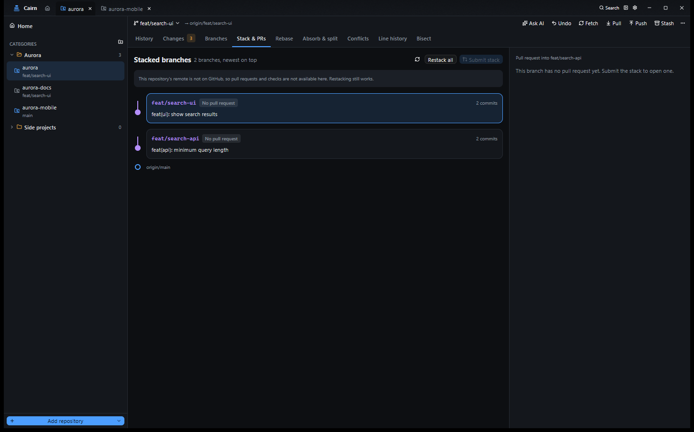</td>
</tr>
<tr>
<td><b>Three-way conflict editor.</b> Ours, base and theirs side by side, one-click choices per
block and a live preview of the result. Cairn opens it by itself when a pull or rebase stops.</td>
<td><b>Stacked branches and pull requests.</b> Cairn remembers which branch sits on which, so
amending a lower branch and restacking just works. Submit the whole stack to GitHub at once.</td>
</tr>
</table>

### Many repositories at once

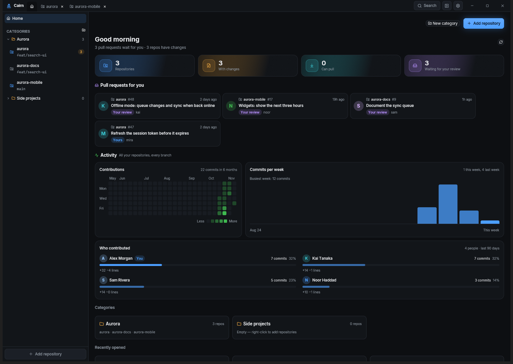

**Home shows where you stand.** What needs you right now, every pull request waiting for your
review across all repositories, and activity charts: a contribution calendar, commits per week
and who contributed how much.

Categories work like folders for your repositories. Open one to fetch, pull or switch every
repository together, and see every pull request **waiting for your review** across them in one
place. When several repositories are on a branch with the same name, Cairn treats them as one
**linked change** you commit and push in a single step.

### Investigate

<table>
<tr>
<td width="50%">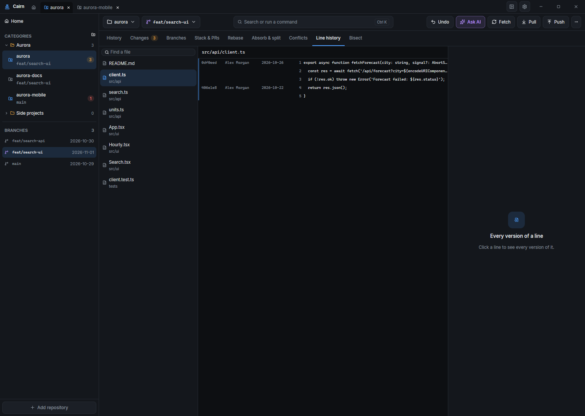</td>
<td width="50%">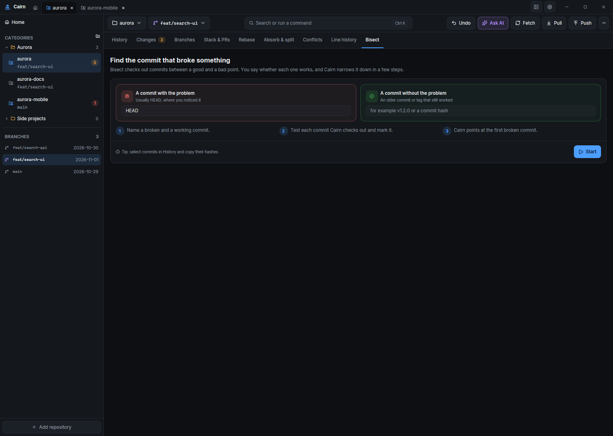</td>
</tr>
<tr>
<td><b>Line history.</b> Blame with age coloring, and every earlier version of any line.</td>
<td><b>Visual bisect.</b> Mark commits good or bad, or let a test command decide, and Cairn
narrows down the commit that broke things.</td>
</tr>
</table>

### Ask AI

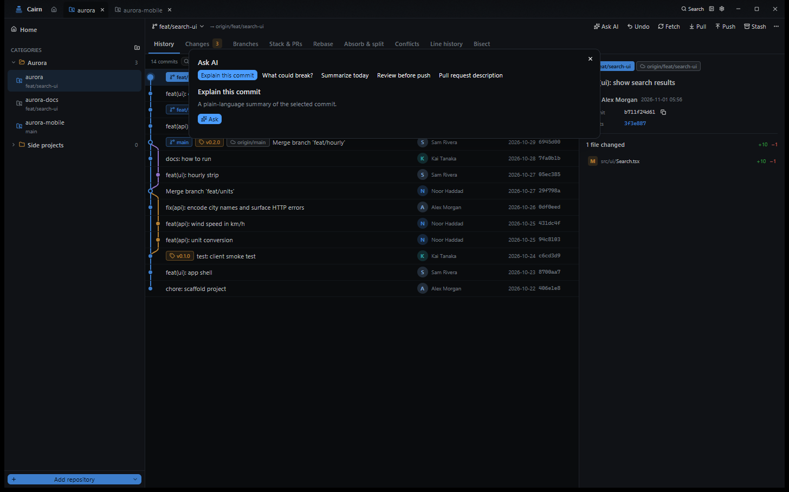

Explain a commit, spot what could break, summarize your day, review before you push, write a
commit message or a pull request description, or get a suggestion for a tricky conflict.

- Connect with an **Anthropic API key**, your **Claude Code** login on this computer, or a
  **custom endpoint**.
- **Off until you turn it on.** Paths you exclude (such as `.env` files) are never sent, and
  anything that looks like a secret is redacted first.
- A monthly spending limit keeps costs predictable.

### Safety net

- **Undo history** for every operation, with uncommitted work stashed safely before going back.
- **No surprises.** Reset, force push, discard and delete say what will happen, what you would
  lose and whether you can get it back, before you confirm.
- **Discards you can take back.** Cairn keeps a copy before discarding changes or a hard reset;
  Lost & found → Discarded changes brings them back.
- **Main stays clean.** Committing straight to `main` offers to put the commit on a new branch
  named after its message.
- **Live progress.** Push, pull and fetch show how far along they are in a corner toast, with a
  button to stop them.
- **Sync your way.** Push or sync right after each commit, confirm before syncing, and get a
  warning when someone rewrote the branch on the server. Switching to a branch brings it up to
  date first.
- **Checks before commit and push** from a `.cairn/checks.toml` file in your repository.
- **Secret scan** that stops API keys, tokens and private keys from leaving your computer.
- **Protected main**: Cairn asks before rewriting history on `main` or `master`.

### Made to fit

<table>
<tr>
<td width="50%">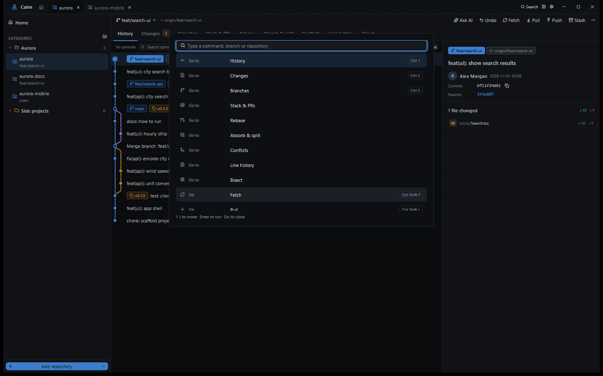</td>
<td width="50%">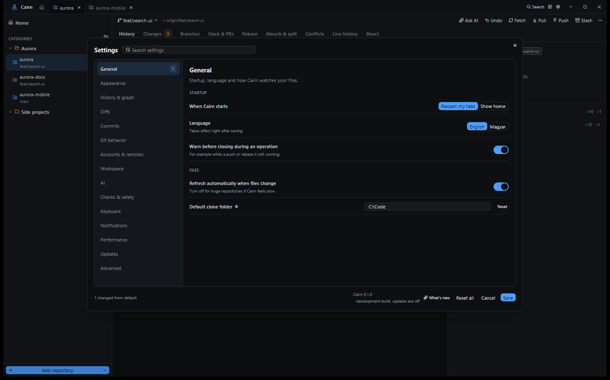</td>
</tr>
<tr>
<td><b>Command palette</b> for every page, git command, branch and repository.</td>
<td><b>About 90 settings</b> with search and live preview: themes, accent colors, graph style,
diff options, identity profiles, signing, AI commit message rules and more.</td>
</tr>
</table>

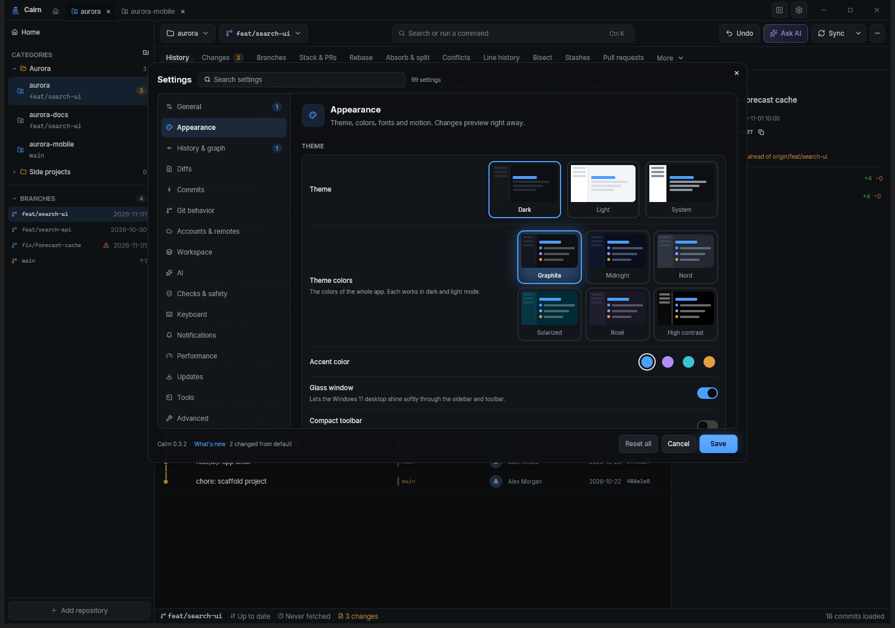

**Make it yours.** Six color themes (Graphite, Midnight, Nord, Solarized, Rosé and High
contrast), each in dark and light, four accent colors, a glass window on Windows 11 and a
compact toolbar. Drag the panel edges to resize them; Cairn remembers.

**Fast by design.** Tabs load only when you open them, pages keep what they showed, staging and
committing update the screen before git has even finished, huge diffs open with their first part
right away, and skeleton placeholders show the shape of the page while it loads. One **Sync**
button fetches, pulls and pushes whatever is needed, and the status bar shows where you stand.

Cairn updates itself in the background (or when you press "Check now" in Settings → Updates) and
shows what changed after each update:

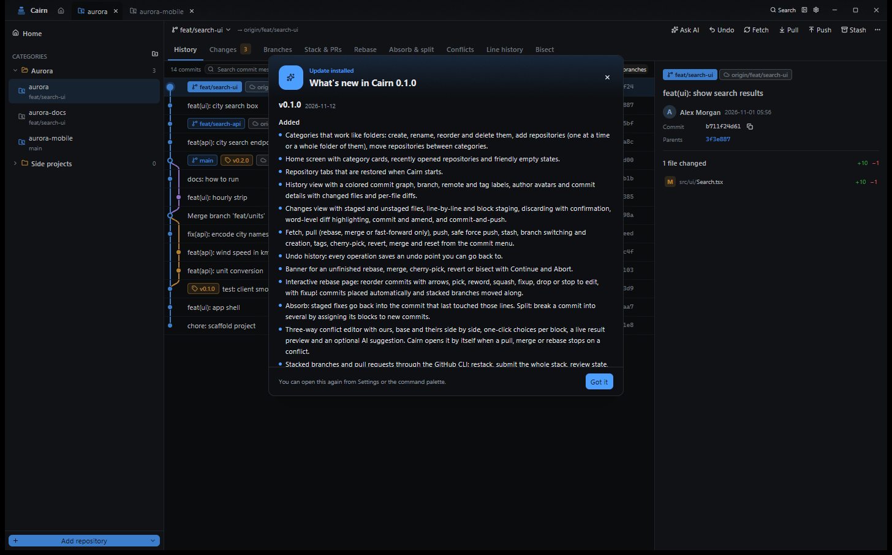

## Install

Download `dev.cairn.app-win-Setup.exe` from the
[latest release](https://github.com/JackLuciano/cairn/releases/latest) and run it. It installs for
your user only, no admin rights needed. Updates arrive automatically.

Windows releases are signed through [SignPath Foundation](https://signpath.org/), which provides
free code signing for open source projects (see the [code signing policy](CODE_SIGNING_POLICY.md)
for how releases are signed and what Cairn sends over the network). Until signing is active,
Windows SmartScreen may ask you to confirm the first time ("More info", then "Run anyway").

**Requirements**

- Windows 10 or 11. Experimental macOS (Apple Silicon and Intel) and Linux x64 builds are attached
  to each release as `.tar.gz` files: plain binaries, not yet signed and without automatic updates.
  On macOS run `xattr -d com.apple.quarantine cairn` once after unpacking.
- [Git](https://git-scm.com/download/win) 2.40 or newer on your `PATH`
- Optional: the [GitHub CLI](https://cli.github.com) for pull requests (run `gh auth login` once)

## Keyboard shortcuts

| Action | Keys |
| --- | --- |
| Command palette | <kbd>Ctrl</kbd> <kbd>K</kbd> or <kbd>Ctrl</kbd> <kbd>Shift</kbd> <kbd>P</kbd> |
| Go to file | <kbd>Ctrl</kbd> <kbd>P</kbd> |
| Settings | <kbd>Ctrl</kbd> <kbd>,</kbd> |
| History, Changes, Branches | <kbd>Ctrl</kbd> <kbd>1</kbd> · <kbd>2</kbd> · <kbd>3</kbd> |
| Commit staged changes | <kbd>Ctrl</kbd> <kbd>Enter</kbd> |
| Fetch · Pull · Push | <kbd>Ctrl</kbd> <kbd>Shift</kbd> <kbd>F</kbd> · <kbd>L</kbd> · <kbd>K</kbd> |
| Stash | <kbd>Ctrl</kbd> <kbd>Shift</kbd> <kbd>S</kbd> |
| New branch | <kbd>Ctrl</kbd> <kbd>Shift</kbd> <kbd>B</kbd> |
| Ask AI | <kbd>Ctrl</kbd> <kbd>Shift</kbd> <kbd>A</kbd> |
| Undo history | <kbd>Ctrl</kbd> <kbd>Z</kbd> |
| Refresh | <kbd>F5</kbd> |
| Next · previous tab · close tab | <kbd>Ctrl</kbd> <kbd>Tab</kbd> · <kbd>Ctrl</kbd> <kbd>Shift</kbd> <kbd>Tab</kbd> · <kbd>Ctrl</kbd> <kbd>W</kbd> |

Optional Vim keys can be turned on in Settings → Keyboard: <kbd>j</kbd> <kbd>k</kbd> move,
<kbd>g</kbd> <kbd>G</kbd> jump to the top and bottom, <kbd>/</kbd> searches, <kbd>s</kbd> stages,
<kbd>f</kbd> fetches and <kbd>p</kbd> pushes.

## Checks before commit and push

Put a `.cairn/checks.toml` file in a repository:

```toml
[[check]]
name = "Lint"
run = "cargo clippy -- -D warnings"
on = ["push"]
blocking = true

[[check]]
name = "Unit tests"
run = "npm test"
on = ["commit", "push"]
blocking = false
```

`on` lists when the check runs: `"commit"`, `"push"` or both (the default is push only). A failing
blocking check stops the commit or push; a non-blocking one only warns.

## Languages

The interface is available in **English** and **Hungarian** (Magyar). Switch in
Settings → General → Language.

## Build from source

You need [Rust](https://rustup.rs) 1.100 or newer and Git. `rust-toolchain.toml` makes rustup
install the right version for you.

```bash
cargo run -p cairn
```

Release build:

```bash
cargo build -p cairn --release
```

Run the tests and lints the same way CI does:

```bash
cargo clippy --workspace --all-targets -- -D warnings
```

```bash
cargo test --workspace
```

### Project layout

| Path | What it is |
| --- | --- |
| `crates/core` | The git engine: history, graph layout, status, diffs, line staging, rebase, absorb, conflicts, stacks, checks, undo, settings. No UI, fully tested. |
| `crates/app` | The desktop app: windows, pages and dialogs built on GPUI and GPUI Kit. |
| `crates/app/locales` | English and Hungarian translations. |
| `scripts` | Version bump and the local Windows release script. |

Settings live in `%APPDATA%\Cairn\settings.toml`, categories and open tabs in
`%APPDATA%\Cairn\library.json`. API keys are stored in Windows Credential Manager, never in files.

## Contributing

Issues and pull requests are welcome. Use the bug report, feature request or translation form
when you [open an issue](https://github.com/JackLuciano/cairn/issues/new/choose). Please run clippy
and the tests before opening a pull request, and add an entry under `[Unreleased]` in
[CHANGELOG.md](CHANGELOG.md) for anything users will notice. Releases are described in
[RELEASING.md](RELEASING.md).

## License

Licensed under either of [Apache License 2.0](LICENSE-APACHE) or [MIT license](LICENSE-MIT), at
your option.
